# CUDA Lab: From GPU Architecture to Kernel Optimization

[](https://colab.research.google.com/github/ash07b/gpu-cuda-architecture/blob/main/CUDA_GPU_Architecture_Project.ipynb)

An end-to-end, runnable GPU computing lab in a single Google Colab notebook. It ties each GPU architecture concept to **CUDA C++ kernels I wrote**, a **correctness test**, and a **measurement taken on whatever GPU the runtime provides**.

```
hardware discovery → execution model → custom CUDA kernels → memory behaviour
  → parallel algorithms → benchmarking → optimization (tiling, fusion) → small ML workload
```

The notebook doesn't hard-code a GPU model or a benchmark number. It queries every device fact at runtime and generates every result from the current session. The committed copy keeps its outputs from a [Tesla T4 run](#results-tesla-t4-on-google-colab).

---

## What's inside

| Part | Topic | Custom CUDA kernel(s) | Compared against |
|---|---|---|---|
| A | GPU system discovery: SMs, compute capability, memory, versions | — | — |
| B | Mental model: grid → blocks → warps → SMs → memory hierarchy, occupancy, divergence | — | — |
| C | PyTorch on the GPU: H2D/D2H transfers, asynchronous execution, correct timing | — | CPU |
| D | First kernel: `nvcc` → `.so` → `ctypes`, with edge-case tests and a block-size sweep | `vector_add` | `torch.add` |
| E | Launch geometry: 1-D/2-D indexing, idle threads, warps | `record_1d`, `record_2d` | index formula |
| F | Memory: coalesced vs strided reads, naive vs shared-memory tiled transpose | `copy_coalesced`, `gather_strided`, `transpose_naive`, `transpose_tiled` | `tensor.t().contiguous()` |
| G | Reduction: atomics vs two-stage tree, floating-point non-associativity | `reduce_atomic`, `reduce_tree` | `torch.sum`, float64 reference |
| H | Matrix multiply: naive vs 16×16 shared-memory tiling, arithmetic intensity | `matmul_naive`, `matmul_tiled` | cuBLAS (`torch.matmul`), CPU |
| I | Kernel fusion: `relu(α·x + β)` as 3 vs 2 vs 1 kernels | `scale_shift` + `relu`, `fused_scale_shift_relu` | PyTorch op chain |
| J | Benchmark methodology: warm-up, CUDA events, noise, transfer vs kernel time, `torch.profiler` | — | — |
| K | Small ML workload: MLP training on synthetic data, CPU vs GPU | — | — |
| L | Results table, plots, automatic interpretation, limitations, extensions | — | — |

Each major experiment follows the same structure: **concept → why it matters → implementation → correctness check → benchmark → interpretation → common mistakes → mini exercise** (the hint comes before the solution).

## How the custom kernels are wired in

```
PyTorch tensor (GPU memory) ──data_ptr()──► ctypes ──► launch_xxx(...) in build/xxx.so
                                                            │ kernel<<<grid, block, smem, stream>>>
torch.cuda.Event ── record ─────────── same CUDA stream ────┘
```

* `nvcc` compiles each `kernels/*.cu` file into a shared library for the GPU's exact compute capability (`-arch=sm_XY`). If that fails it retries with `-arch=native`, then with PTX that the driver JIT-compiles.
* Python passes raw device pointers from PyTorch tensors plus PyTorch's **current CUDA stream**. Custom kernels and PyTorch kernels therefore run in order on the same stream, and the same CUDA events time both.
* Every launcher returns a `cudaError_t`. Python raises a readable error for any non-zero code, and correctness tests call `torch.cuda.synchronize()` so that asynchronous execution errors also surface.

## Run it

1. Click **Open in Colab** above.
2. Go to **Runtime → Change runtime type → GPU** (a T4 is fine).
3. Click **Runtime → Run all**. On a T4 the full run takes a few minutes.
4. Download `results/benchmark_results.csv` and `results/*.png` from the Colab file browser before the runtime disconnects.

The notebook still runs when parts of the stack are missing:

| Runtime | What happens |
|---|---|
| GPU + `nvcc` (standard Colab GPU runtime) | Everything runs, including the custom CUDA C++ kernels. |
| GPU, no `nvcc` | Custom-kernel cells print a warning and run **clearly labelled PyTorch fallbacks**. The fallbacks are never presented as custom kernels. |
| CPU only | GPU cells print `skipped: no CUDA GPU`. CPU references, the reduction precision demo, the MLP and the results table still run. |

To run it locally on a machine with an NVIDIA GPU and the CUDA toolkit:

```bash
pip install -r requirements.txt
jupyter notebook CUDA_GPU_Architecture_Project.ipynb
```

## Repository layout

```
gpu-cuda-architecture/
├── CUDA_GPU_Architecture_Project.ipynb   # the lab (Parts A–L)
├── kernels/
│   ├── common.cuh                        # export macro + error-string helper
│   ├── vector_add.cu                     # Part D
│   ├── launch_geometry.cu                # Part E
│   ├── memory_access.cu                  # Part F: coalesced/strided, naive/tiled transpose
│   ├── reduction.cu                      # Part G: atomic vs tree reduction
│   ├── tiled_matmul.cu                   # Part H: naive vs shared-memory tiled GEMM
│   └── fused_elementwise.cu              # Part I: unfused vs fused relu(a*x+b)
├── results/                              # CSV, plots and environment from the T4 run (rewritten on each run)
├── docs/screenshots/                     # notebook output screenshots used in this README
├── tools/
│   └── build_notebook.py                 # regenerates the notebook from kernels/ + cell sources
├── requirements.txt
└── README.md
```

`kernels/*.cu` is the single source of truth for the CUDA code. The notebook embeds the same files as `%%writefile` cells so that it works when opened directly in Colab. After editing a kernel, regenerate the notebook so the two copies stay identical. Regenerating produces a clean notebook without outputs:

```bash
pip install nbformat
python tools/build_notebook.py
```

## Results: Tesla T4 on Google Colab

All numbers below come from one full run of the committed notebook. Its outputs are saved in the notebook, so you can read them on GitHub without running anything. The run used a **Tesla T4** (compute capability 7.5, 40 SMs, 4 MiB L2), PyTorch 2.11 with CUDA 13.0, and `nvcc` 13.0. All kernels were built with `-arch=sm_75`. **Every correctness check passed**, covering 23 measured implementations plus the edge-case sizes.

| Experiment | Result on T4 | Takeaway |
|---|---|---|
| Vector add (16.8 M floats) | custom kernel **255.8 GB/s**, PyTorch 237.0 GB/s, CPU 13.2 GB/s | A simple bandwidth-bound kernel reaches ~80% of the T4's 320 GB/s datasheet peak. 32-thread blocks drop to 117.9 GB/s. |
| PCIe vs kernel | H2D copy 4.7 GB/s; end-to-end add 75.1 ms vs 0.85 ms kernel-only | The kernel is **1.1%** of end-to-end time, so transfers dominate cheap ops. |
| Coalesced vs strided reads | **230.0 GB/s** coalesced → **21.2 GB/s** at stride 128 | The same bytes with a different access pattern give a **10.8×** slowdown. |
| Transpose 4096×4096 | tiled **187.9 GB/s**, naive 54.3 GB/s, PyTorch 140.0 GB/s | Shared-memory tiling with bank-conflict padding gives a **3.5×** speedup. |
| Sum reduction (16.8 M floats) | tree **0.267 ms (250.9 GB/s)**, `torch.sum` 0.268 ms, atomics 33.4 ms | The tree matches PyTorch and is **125×** faster than atomics. Its relative error is 3.5e-8, vs 1.6e-5 for atomics. |
| Matmul 1024³ FP32 | cuBLAS **6,030 GFLOP/s**, tiled 772, naive 434, CPU 125 | Tiling gives a 1.8× speedup. cuBLAS is still 7.8× ahead (register tiling, vector loads, pipelining). |
| Fusion `relu(α·x+β)` | 3 kernels 1.717 ms → 2 kernels 1.157 ms → **1 kernel 0.591 ms** | A **2.9×** speedup. All three versions run at ~230 GB/s of real traffic, matching the 3 : 2 : 1 memory-traffic model. |
| MLP training (65 k samples) | GPU **113.6 ms/epoch** vs CPU 1,183 ms/epoch | **10.4×** faster, with matching loss curves (1.440 → 1.105). |

<p align="center">
  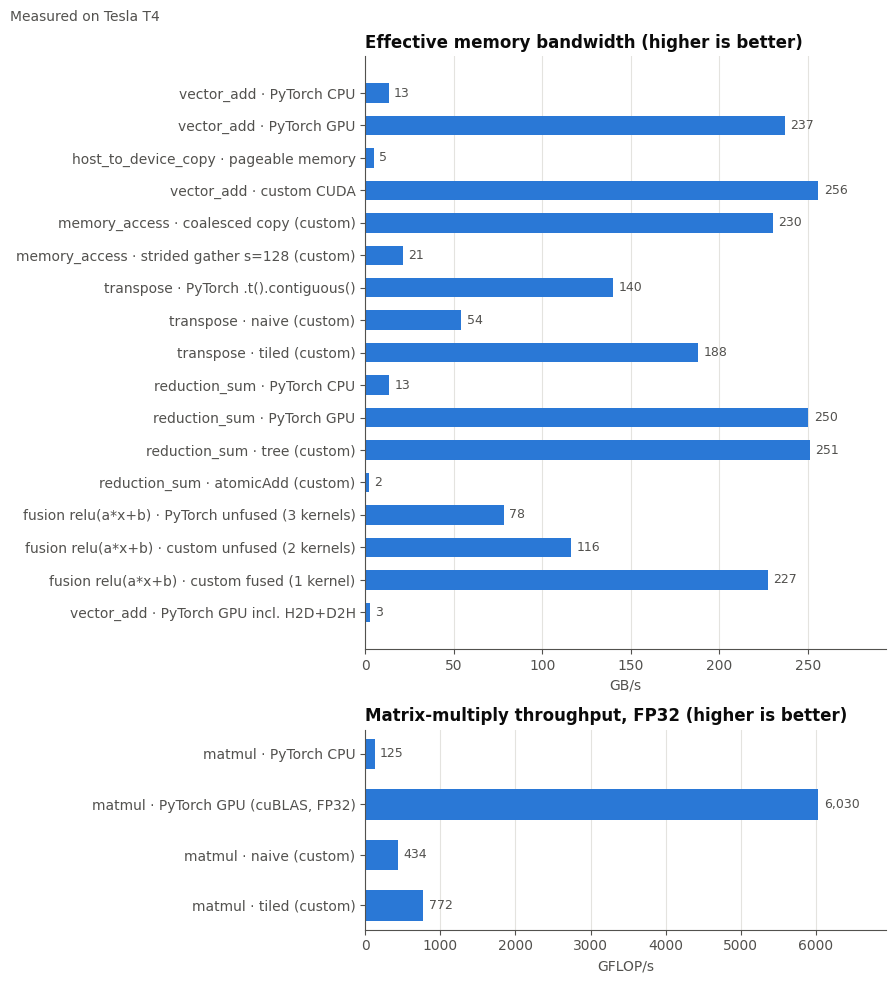
</p>

<p align="center">
  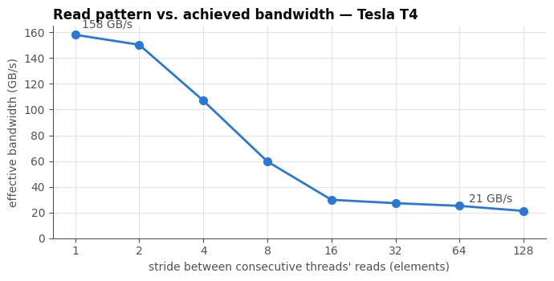
  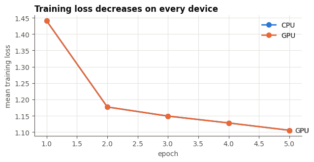
</p>

### Output screenshots

| | |
|---|---|
| **GPU discovery** (Part A)<br>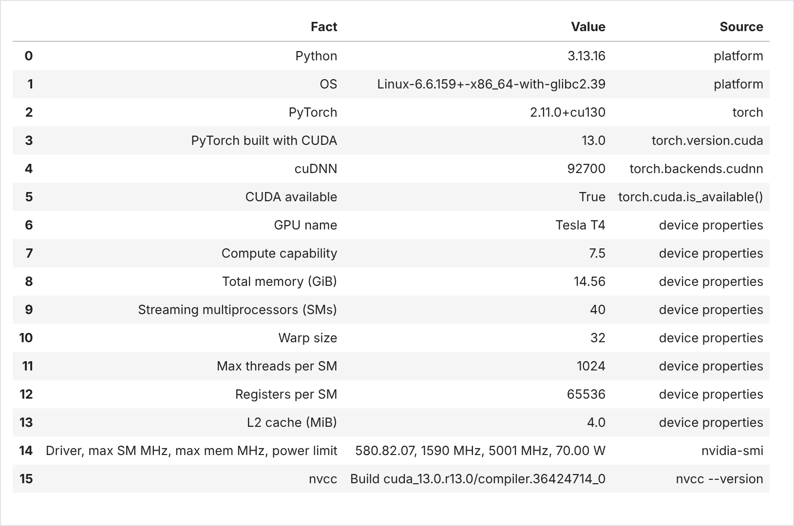 | **Custom vector-add edge cases** (Part D)<br>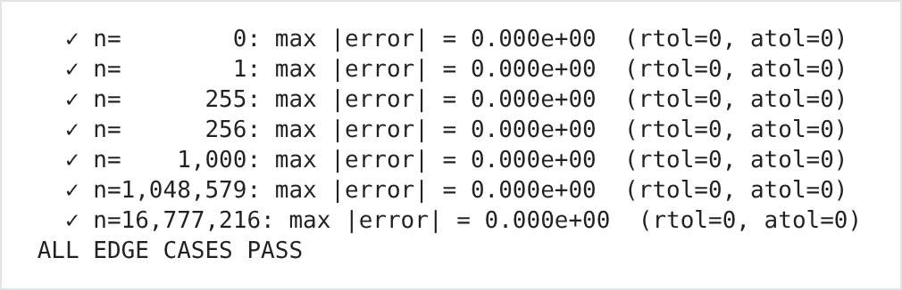 |
| **Block-size sweep** (Part D)<br>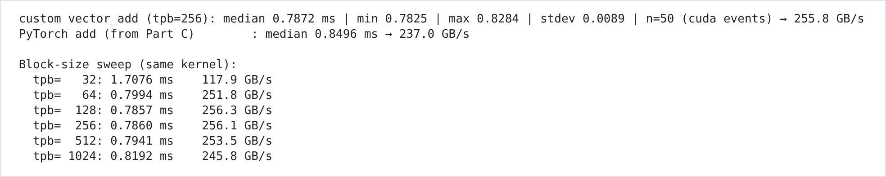 | **Launch geometry from a real kernel** (Part E)<br>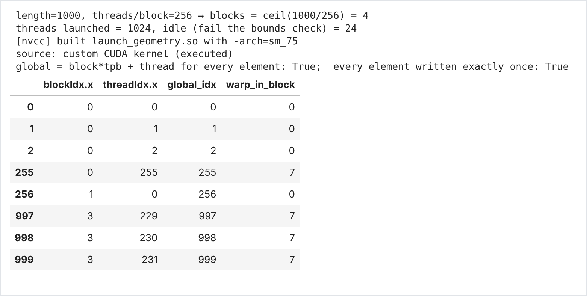 |
| **Coalesced vs strided** (Part F)<br>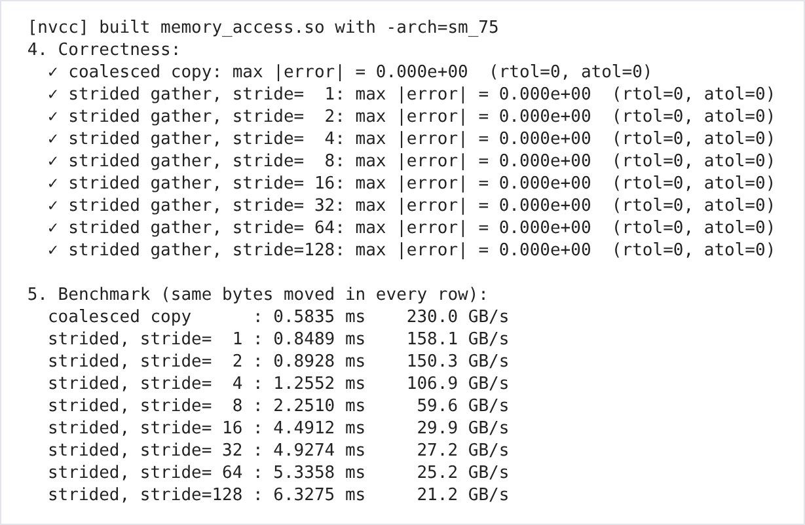 | **Naive vs tiled transpose** (Part F)<br>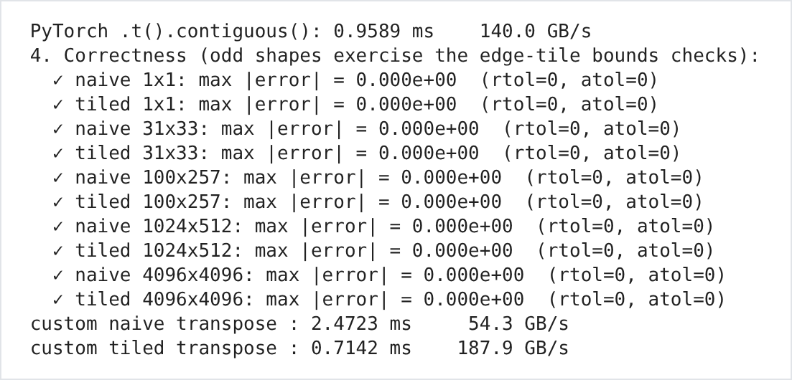 |
| **Reduction: accuracy and speed** (Part G)<br>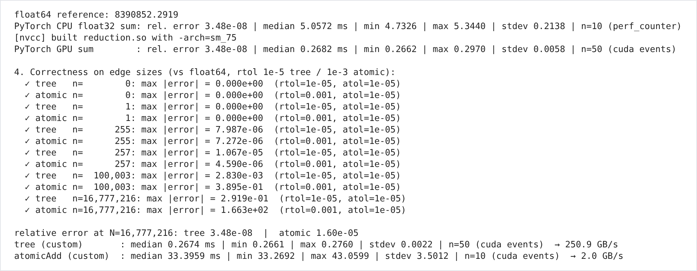 | **Matmul correctness** (Part H)<br>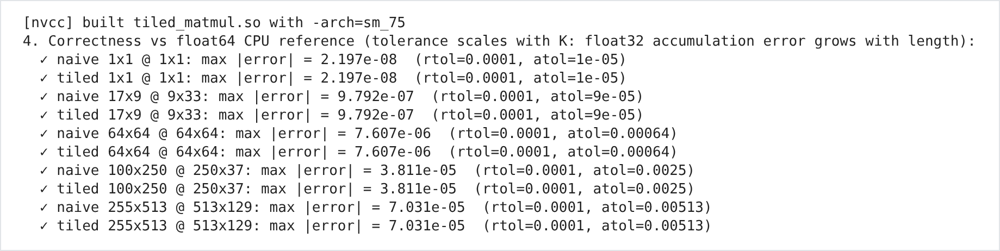 |
| **Matmul throughput** (Part H)<br>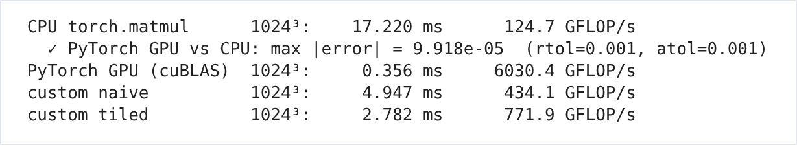 | **Kernel fusion** (Part I)<br>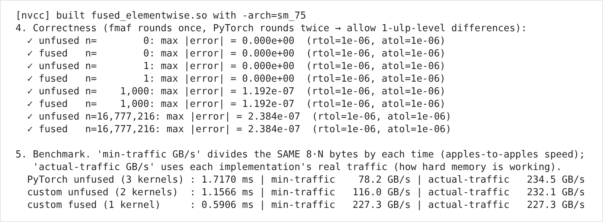 |
| **`torch.profiler` kernel trace** (Part J)<br>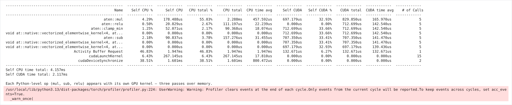 | **Automatic interpretation** (Part L)<br>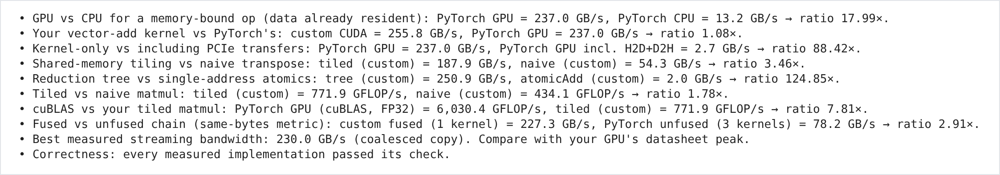 |

The full results table is in [`results/benchmark_results.csv`](results/benchmark_results.csv), with a [screenshot](docs/screenshots/14_results_table.png). The environment record is in [`results/environment.json`](results/environment.json). Re-running the notebook on another GPU regenerates every file in `results/`.

## Methodology at a glance

* **Timing:** warm-up iterations, then CUDA events recorded on the work's stream, with the **median** of many trials reported. CPU timings use `time.perf_counter`.
* **Bandwidth:** `(bytes read + bytes written) / time`. **Throughput:** `2·M·N·K / time` for matmul.
* **Fair comparisons:** each benchmark states whether transfers are included, plus the tensor size and dtype. TF32 is disabled so that cuBLAS is compared against FP32 kernels in FP32.
* **Correctness:** every custom kernel is checked against PyTorch or a float64 CPU reference, on edge-case sizes as well as large ones. Exact equality is used where the arithmetic is exact (copies, adds), and tolerances where the summation order differs (reductions, matmul).

## Limitations and extensions

The kernels are deliberately simple teaching versions: no vectorized loads, register tiling or warp shuffles. Every experiment uses FP32 on a single stream. Colab doesn't normally provide Nsight, so the notebook relies on event timing and `torch.profiler`. Suggested next steps, covered in Part L, include CUDA streams and pinned memory, occupancy analysis (`-Xptxas -v`), warp-shuffle reductions, Tensor Cores and mixed precision, Triton, CUTLASS, `torch.compile`, and Nsight Systems/Compute.

## License

MIT. See [LICENSE](LICENSE).
